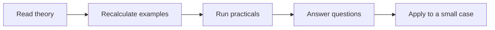

# 11 — Interview Preparation

[Learning Hub](../README.md)

**[Start the algorithm story](01-theory/ALGORITHM-STORY.md)** — understand the problem, mechanism, limitation and related alternatives.

**Learn in order:** Clarify → Solve small case → Explain → Check → Diagnose → Retry

| Section | What to do |
|---|---|
| [01 — Theory](01-theory/README.md) | 4 numbered lessons, analogies, diagrams and worked examples; extended guides for more detail |
| [02 — Practicals](02-practicals/README.md) | New runnable lab plus preserved notebooks, exercises and assignments |
| [03 — Questions and answers](03-questions-and-answers/README.md) | 12 explained answers in course order |
| [Archive](archive/README.md) | Original reference documents and handwritten PDFs |

Start with the first theory lesson. Predict code output or calculate the result before running/checking it. Keep an error log and revisit the specific concept when an answer is wrong. Examples use simplified or synthetic data unless stated otherwise. Original material is preserved; some historical notebooks may require their own datasets or older dependencies.

[← Economics And Finance](../10-economics-and-finance/README.md) · [Business Analytics And Coursework →](../12-business-analytics-and-coursework/README.md)
