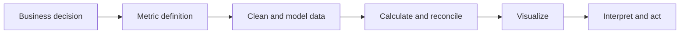
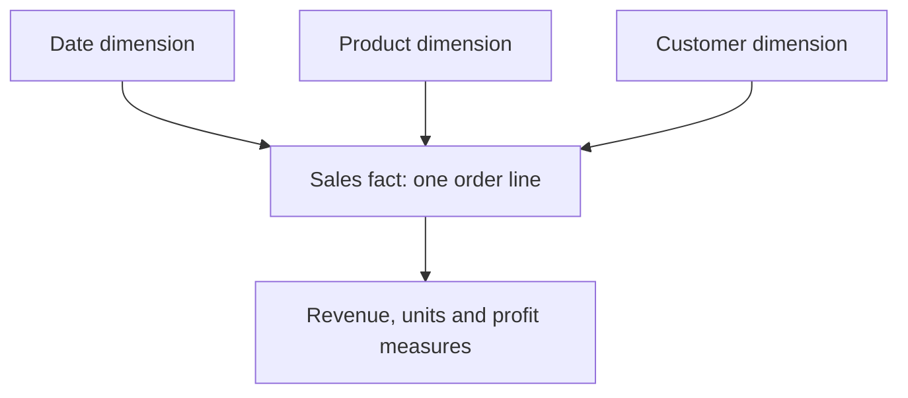
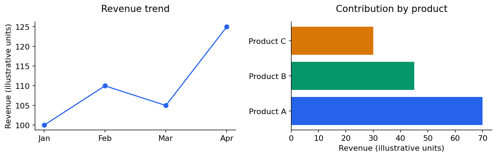

# Business analytics: from a question to a useful dashboard

[Subject home](../README.md) · [Theory index](README.md)

A dashboard should help someone decide what to do. Start with the audience, decision, metric and data grain; then choose a tool. The existing Excel, SQL, Tableau and Power BI exercises become easier when those definitions are clear.

## On this page

- [1. Frame a measurable question](#1-frame-a-measurable-question)
- [2. Clean and model the data](#2-clean-and-model-the-data)
- [3. Calculate before decorating](#3-calculate-before-decorating)
- [4. Choose the chart by the comparison](#4-choose-the-chart-by-the-comparison)
- [5. Stories, security and practical exercises](#5-stories-security-and-practical-exercises)
- [6. A repeatable review](#6-a-repeatable-review)

## 1. Frame a measurable question

“Sales are down” is a symptom. Ask which period, product, region and customer group changed; distinguish units, price, mix, returns and currency. An explanatory narrative requires evidence, not a guess based on the most visible chart.

| Metric | Example definition | Common trap |
|---|---|---|
| Net sales | Gross sales minus returns/discounts under a stated policy | Mixing gross and net |
| Margin | Profit / revenue | Averaging percentages without weights |
| Conversion | Qualifying conversions / eligible visitors | Mixing events with unique people |
| Retention | Returning eligible cohort members / original eligible cohort | Incomplete observation periods |
| Average order value | Revenue / distinct qualifying orders | Counting order lines as orders |

Include reporting period, timezone, exclusions and owner for an important KPI. Distinguish a target from an observed value and an estimate from a settled total.

## 2. Clean and model the data

Inspect types, nulls, duplicates, inconsistent names and dates. In Excel, keep a rectangular table with a header per column and one logical record per row; avoid merged cells in the analysis table. Power Query-style transformations can make repeated cleanup more reproducible than manually editing cells.

A fact table records events at a defined grain; dimension tables describe products, dates and customers. In a star schema, many fact rows relate to one dimension row. A many-to-many relationship can produce surprising totals; check key uniqueness and filter paths.

## 3. Calculate before decorating

Excel functions such as `SUMIFS` and `COUNTIFS` aggregate with conditions; lookup operations retrieve attributes by a key. Decide how unmatched and duplicate keys should behave. Pivot tables summarize groups; always reconcile their grand totals to the intended source rows and filters.

In Power BI, a calculated column is evaluated per row and stored in the model, while a measure is evaluated in a filter context. A slicer changes that context. A ratio measure should usually divide aggregated numerator by aggregated denominator, rather than average row ratios. In Tableau, understand the view's level of detail and the order/filter behaviour of a calculation before interpreting the result.

### A complete margin calculation

Order A has revenue 100 and profit 20; B has revenue 900 and profit 90. Individual margins are 20% and 10%. Their simple average is 15%, but the overall margin is $(20+90)/(100+900)=11\%$. A dashboard showing 15% as the overall margin is incorrect for this definition.

## 4. Choose the chart by the comparison

Use a line for a time pattern, sorted bars for category comparisons, a scatter plot for two measurements and a table for precise lookup. A histogram describes a distribution rather than a time trend. Show units and sensible scales. A truncated axis can exaggerate bar differences; a crowded pie chart makes small categories hard to compare.

Keep colour meanings consistent, label important values and include date/filter context. Avoid using colour alone for critical distinctions. Show uncertainty or incomplete-data status when a point is estimated. A useful tooltip adds detail without making the main view depend on hidden text.

## 5. Stories, security and practical exercises

A data story has a question, evidence, interpretation and a proposed next step. Separate “observed”, “likely explanation” and “needs further testing”. Drill-down can reveal a local issue hidden in a total. Compare like-for-like periods and check seasonality before calling a movement a new trend.

For row-level security, define which user should see which rows and test allowed and disallowed views. A hidden page is not an access-control mechanism. Publish only the data needed for the audience and respect the material's permissions.

The practical library contains BI assignments, student-spend/product/acquisition cases, stories, security and dashboard work. Read a project's brief, inspect its data and workbook, reproduce one key metric, then explain why the chosen view answers the question. Do not assume an existing workbook's answers are validated just because the file opens.

## 6. A repeatable review

Check grain and keys; reconcile totals; test slicers and empty selections; inspect dates, nulls and units; verify that title and comparison period match the visible data. Finally, ask whether the reader can identify the intended decision without a verbal explanation. Record the insight and its limitation next to the chart.

[Try the practicals](../02-practicals/README.md)
