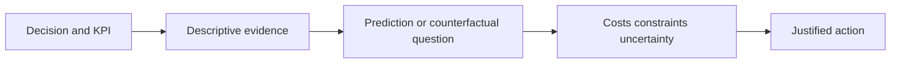

# How business-analytics methods progress from counts to decisions

[Subject home](../README.md) · [Foundation course](README.md) · [Practicals](../02-practicals/README.md)

An algorithm is useful only when it answers the business question with credible data. Descriptive, predictive, causal and optimization methods solve different questions.

## Read the motivation, mechanism and trade-off together

| Family / transition | Limitation or question | How the method works | What remains / why another branch matters | Read |
|---|---|---|---|---|
| Raw counts → rate/weighted KPI contracts | Different populations/denominators create incomparable numbers. | Pool the intended numerator/denominator at a declared grain. | Averages of subgroup rates can be wrong for the total. | [Lesson](lesson-01-business-questions-and-kpis.md) |
| Ad hoc sheets → lookup/pivot/semantic models | Repeated manual analysis is inconsistent and fragile. | Use validated keys, grouped summaries, relationships and shared measures. | Lookups/relationships still need cardinality, context and reconciliation checks. | [Lesson](lesson-03-bi-model-and-dax.md) |
| Pooled users → cohort / funnel / RFM segmentation | Aggregate behaviour hides maturity and user-process differences. | Align starting events and windows; summarize staged or recency/frequency/value behaviour. | A segment is descriptive, not automatically a causal response group. | [Lesson](lesson-05-customer-product-and-operations.md) |
| Observed credit → experimental incrementality / uplift | Attribution does not identify additional outcomes caused by an action. | Compare credible counterfactuals under randomized or justified observational assumptions. | Selection, interference and missing outcomes can invalidate lift claims. | [Lesson](lesson-05-customer-product-and-operations.md) |
| Historical description → forecasting / churn / value models | Decisions may depend on future demand or behaviour. | Fit a target-specific predictor under correct timing, losses and validation. | Prediction does not by itself say which intervention changes outcomes. | [Lesson](lesson-05-customer-product-and-operations.md) |
| Average flow → queues / inventory / constrained optimization | Resource capacity and uncertainty affect feasible actions. | Model arrival/service/inventory relationships and optimize a stated cost/service objective. | Stability, distribution and operational assumptions determine usefulness. | [Lesson](lesson-05-customer-product-and-operations.md) |
| One scenario → sensitivity / simulation / decision analysis | Uncertain inputs can change the recommendation. | Vary key assumptions or simulate a justified joint model and compare alternatives. | Simulation repeats assumptions; it does not create evidence that they are true. | [Lesson](lesson-06-cases-and-capstone.md) |

## How to compare alternatives

Use the same task, eligible data, split/horizon and compute budget. State the objective, assumptions, training/update procedure, important settings and failure cases. A newer publication can address one bottleneck while being worse on another. A survey row identifies a family; it does not pretend to derive every research variant.

For a method you study, complete this sentence: “I would consider it because ___; it works by ___; I would compare it with ___ using ___; I would avoid or investigate it when ___.” Recalculate the worked examples before selecting by a method name.
