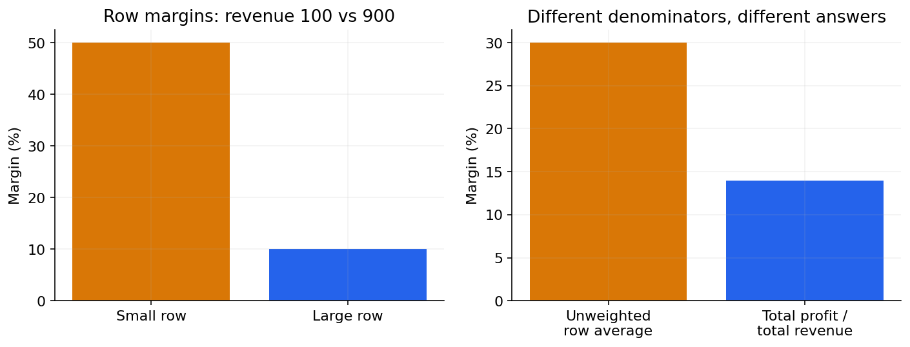

# 01 — Business questions, metric trees and KPI contracts

[Course map](README.md) · [Practicals](../02-practicals/README.md) · [Questions](../03-questions-and-answers/worked-questions.md#lesson-01)

The total margin must weight rows by revenue. See the worked example for its assumptions.

## On this page

- [The idea](#the-idea)
- [Work through it](#work-through-it)
- [Common mistakes and practical limits](#common-mistakes-and-practical-limits)

## The idea

**Analogy:** A KPI is a measuring instrument with a label, denominator and owner—not just a prominent number.

Begin with the decision and who will take it. Define metric numerator, denominator, grain, eligible population, time window, currency/unit and exclusions. Revenue, profit, margin and cash answer different questions. A north-star metric should connect to user/business value and be paired with guardrails so optimizing it does not create predictable harm.

Metric trees decompose outcomes into drivers. Revenue can be customers×orders/customer×revenue/order, with carefully aligned definitions. Decomposition helps locate changes but does not prove which intervention causes improvement. Check instrumentation and definition changes before interpreting a shift as real behaviour.

Set ownership and version metric definitions. If teams use different refund/tax/date rules, identical labels can produce different totals. Show denominators and missingness beside rates where useful. A decision threshold needs costs and capacity, not merely a red/green colour scheme.

## Work through it

Revenue 1000,cost 700 gives profit 300 and margin 30%. Markup over cost is 300/700≈42.86%, a different denominator. Two lines with revenue 100 and 900 and profit 50 and 90 have line margins 50% and 10%; overall margin 140/1000=14%, not their unweighted 30% average.

## Common mistakes and practical limits

Do not label revenue as profit. Avoid changing a metric definition without marking the discontinuity. A good-looking aggregate can hide a loss-making segment.

---

[Subject home](../README.md) · [Excel tables, formulas, lookups, pivots and reconciliation →](lesson-02-excel-and-analysis.md)
