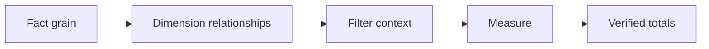

# 03 — BI semantic models, relationships, DAX and filter context

[Course map](README.md) · [Practicals](../02-practicals/README.md) · [Questions](../03-questions-and-answers/worked-questions.md#lesson-03)

## On this page

- [The idea](#the-idea)
- [Work through it](#work-through-it)
- [Common mistakes and practical limits](#common-mistakes-and-practical-limits)

## The idea

**Analogy:** A semantic model is a shared dictionary plus a relationship map for trustworthy calculations.

A star schema separates fact measurements from dimensions used for filtering/grouping. Relationship cardinality, direction and active/inactive paths control how filters propagate. Avoid ambiguous many-to-many relationships unless explicitly designed and tested. A date dimension supports consistent calendar analysis.

In Power BI-style modelling, calculated columns produce row-level values during processing under their model context; measures compute results in an evaluation/filter context. DAX CALCULATE modifies filter context and has context-transition behaviour in appropriate row contexts. A measure is not simply an Excel formula copied over rows.

Define base measures and derived ratios centrally. Test grand totals, subtotals, filters and empty selections: totals often recalculate in a different context rather than sum visible ratios. Row-level security must be configured and tested for actual identities. Report filters or hidden visuals are not equivalent security.

## Work through it

A total margin measure is conceptually DIVIDE(SUM(Profit),SUM(Revenue)), with a deliberate zero-denominator result. It should recompute for each region and for the grand total, not average the displayed region percentages.

If a fact table has one row per order line, a distinct order count and a line count are separate measures.

## Common mistakes and practical limits

A relationship that appears to work for one chart may double-count elsewhere. Do not use bidirectional filtering as a universal fix for modelling errors. Explain row versus filter context before memorizing DAX syntax.

---

[← Excel tables, formulas, lookups, pivots and reconciliation](lesson-02-excel-and-analysis.md) · [Dashboard design, chart choice and accessible storytelling →](lesson-04-dashboards-and-communication.md)
