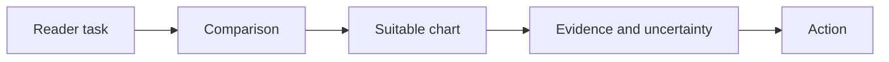

# 04 — Dashboard design, chart choice and accessible storytelling

[Course map](README.md) · [Practicals](../02-practicals/README.md) · [Questions](../03-questions-and-answers/worked-questions.md#lesson-04)

## On this page

- [The idea](#the-idea)
- [Work through it](#work-through-it)
- [Common mistakes and practical limits](#common-mistakes-and-practical-limits)

## The idea

**Analogy:** A dashboard is a decision surface: the reader should see the important comparison without decoding decoration.

Choose charts from the comparison: bars for categories, lines for time, scatterplots for relationships, histograms/ECDFs for distributions. Show units, time window, source freshness and meaningful baselines. Avoid 3Ddistortion, misleading truncated axes and colour-only distinctions. Accessibility includes contrast, readable labels and alternative explanations.

A summary page should answer the main decision; drill-downs explain drivers. Use consistent metric definitions across views. Display uncertainty, missingness or small sample warnings where they change interpretation, not a generic warning on every chart. A red KPI needs a clear threshold and action owner.

Tell a result as observation→possible explanation→evidence/uncertainty→next action. Do not make a causal headline when the chart only shows correlation. Test the dashboard with actual tasks: can a reader identify the relevant comparison and reproduce the number from source data?

## Work through it

Instead of“Revenue is down!”, show“Revenue fell 8% versus the matched prior period; customer count fell 10% while revenue/customer rose 2.2% approximately.”Then investigate tracking and segment mix before recommending a product change.

A bar chart comparing 30% and 31% with a 29% axis origin can exaggerate the visual difference; choose a scale consistent with the chart's purpose.

## Common mistakes and practical limits

Do not put every available metric on one page. More visuals can slow comprehension. A beautiful chart with the wrong denominator is still wrong.

---

[← BI semantic models, relationships, DAX and filter context](lesson-03-bi-model-and-dax.md) · [Customer, product, marketing and operations analytics →](lesson-05-customer-product-and-operations.md)
