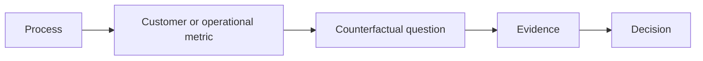
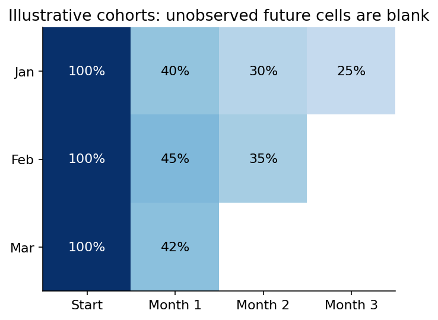

# 05 — Customer, product, marketing and operations analytics

[Course map](README.md) · [Practicals](../02-practicals/README.md) · [Questions](../03-questions-and-answers/worked-questions.md#lesson-05)

Cohorts need comparable follow-up, not survivor-only denominators. See the worked example for its assumptions.

## On this page

- [The idea](#the-idea)
- [Work through it](#work-through-it)
- [Common mistakes and practical limits](#common-mistakes-and-practical-limits)

## The idea

**Analogy:** Business analytics connects a metric to the process that produced it.

Customer analysis includes acquisition, activation, retention, churn and value under explicit definitions. Cohorts need consistent follow-up windows. RFM summarizes recency/frequency/monetary behaviour but does not prove future loyalty or causal responsiveness. Lifetime-value models depend on horizon, margin, retention and discount assumptions.

Marketing attribution allocates observed credit under a rule/model; incremental lift asks what would have happened without the intervention. Last-click credit is not causal contribution. Product experiments need eligible users, randomization, primary/guardrail metrics and interference checks.

Operations analysis tracks throughput, lead time, queue length, capacity and service quality. Little's law relates long-run average work-in-system, arrival rate and time under stability/accounting conditions. Process bottlenecks and variability can dominate averages. Inventory/service decisions require costs and demand uncertainty, not only dashboard targets.

## Work through it

A stable process averaging 10 completed cases/hour with average time-in-system 2 hours has average work-in-system 20 cases under Little's-law conditions. This is a flow relationship, not proof that adding 20 cases improves productivity.

A campaign with 100 attributed purchases may have only 20 incremental purchases relative to a credible counterfactual; attribution and lift answer different questions.

## Common mistakes and practical limits

Do not compare retention for immature and mature cohorts without equal observation windows. Attributed revenue is not incremental profit. Stable-flow assumptions must be checked before applying queue formulas.

---

[← Dashboard design, chart choice and accessible storytelling](lesson-04-dashboards-and-communication.md) · [Business cases, experiments, recommendations and capstone delivery →](lesson-06-cases-and-capstone.md)
