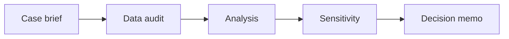

# 06 — Business cases, experiments, recommendations and capstone delivery

[Course map](README.md) · [Practicals](../02-practicals/README.md) · [Questions](../03-questions-and-answers/worked-questions.md#lesson-06)

## On this page

- [The idea](#the-idea)
- [Work through it](#work-through-it)
- [Common mistakes and practical limits](#common-mistakes-and-practical-limits)

## The idea

**Analogy:** A complete analysis closes the loop from question to an auditable decision.

Write a case brief with stakeholder, decision, measurable outcome, data sources, assumptions and constraints. Profile and reconcile data before analysis. Choose a method that answers the question: descriptive decomposition, forecast, predictive model, experiment or causal estimate have different evidence requirements.

A recommendation should include expected direction/magnitude under stated assumptions, uncertainty, cost/capacity implications, risks and a measurable next step. Scenario/sensitivity analysis reveals which uncertain inputs drive the decision. Separate implementation feasibility from statistical promise.

Deliver a reproducible dataset/transform description, metric dictionary, calculations, focused visuals and a short decision memo. Preserve original assignments and explain your own contribution. A portfolio case should distinguish real data, synthetic examples and hypothetical outcomes. Use the existing coursework collections to practice, then rebuild one case from scratch without copying its conclusions.

## Work through it

Capstone: explain a monthly profit decline. Reconcile revenue/cost totals; decompose volume, price, mix and returns; segment with adequate denominators; check definition/data changes; propose a targeted investigation or experiment. Include a table showing how the conclusion changes if a key cost allocation differs by±10%.

## Common mistakes and practical limits

Do not invent business impact for a portfolio. A recommendation with no owner, timing or success measure is difficult to review. Keep confidential source data out of public deliverables.

---

[← Customer, product, marketing and operations analytics](lesson-05-customer-product-and-operations.md) · [Continue with practicals](../02-practicals/README.md)
